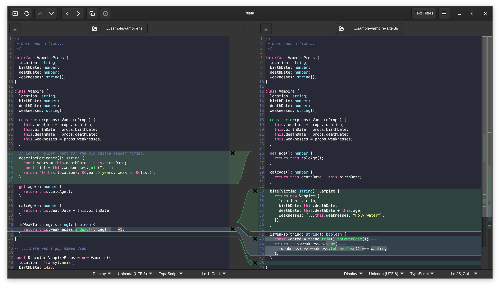
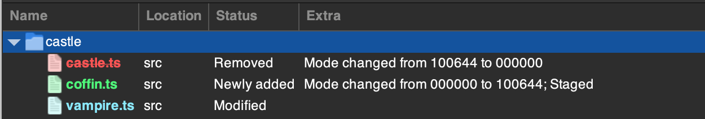

# Dracula for [Meld](https://meldmerge.org)

> A dark theme for [Meld](https://meldmerge.org).

## Install

All instructions can be found at [draculatheme.com/meld](https://draculatheme.com/meld).

## About

Meld draws its diff panes with GtkSourceView 4, so this theme is a GtkSourceView 4
style scheme written from the [Dracula Specification](https://draculatheme.com/spec),
plus Dracula colors for Meld's own diff highlighting.

Diff hues follow the other Dracula diff themes: green for added, red for removed,
cyan for changed and orange for conflicts, with the same tint strengths as
[dracula/visual-studio-code](https://github.com/dracula/visual-studio-code).

One Meld quirk worth knowing: in a file comparison Meld paints lines that exist on
only one side with its "insert" style whichever side they are on, so removed lines
show as green rather than red. Red is used where Meld does distinguish deletions,
in the folder comparison and version control views.

## See also

- [dracula/gtksourceview](https://github.com/dracula/gtksourceview), the Dracula theme for GtkSourceView 5 apps such as GNOME Text Editor and Builder.

## Team

This theme is maintained by the following person(s) and a bunch of [awesome contributors](https://github.com/dracula/meld/graphs/contributors).

|  |
| ------------------------------------------------------------------------------------ |
| [LeafWare](https://github.com/LeafWare)                                              |

## Community

Join thousands of vampires using Dracula Theme around the world 🦇

- [X (Twitter)](https://x.com/draculatheme) and [Instagram](https://www.instagram.com/draculatheme) - Follow for tips, news, and fun.
- [Discord](https://draculatheme.com/discord-invite) - Hang out and chat with the rest of the clan.
- [GitHub Discussions](https://github.com/dracula/dracula-theme/discussions) - Ask questions and discuss issues.

## Dracula PRO

## License

[MIT License](./LICENSE)
